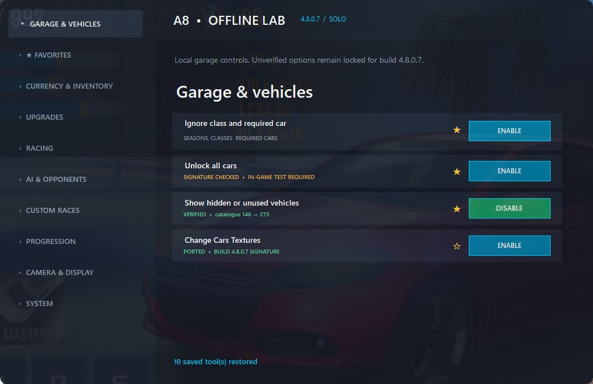
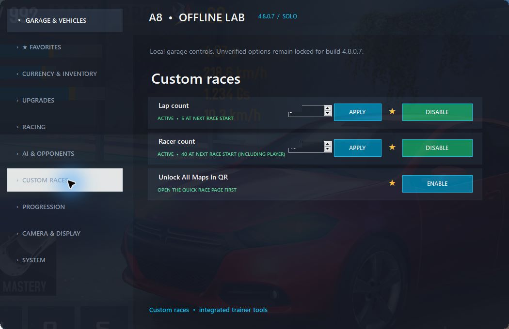

# Asphalt 8 Offline Lab

**A source-available offline launcher and Insert-key trainer for Asphalt 8: Airborne, Windows x86 build 4.8.0.7.**

Keep a local copy of the classic game playable, customize solo races, and manage the garage through a translucent English overlay. The community cheat tables call this release **4.8.0h**; compatibility is checked against the actual executable, rather than the display name alone.

> This is an independent preservation and experimentation project. You must provide your own compatible game installation. Game executables, assets, accounts and save files are not distributed here. Online services are not recreated.

## Screenshots

Real captures from the local Windows build, with the game and trainer set to English.







## What it does

- Launches the registered offline game from one executable.
- Shows or hides a dark translucent mod menu with **Insert**, with categorized tools and starred favorites.
- Remembers enabled tools and numeric settings across menu navigation and game restarts.
- Migrates settings and favorites created by the earlier French interface.
- Applies version-specific native patches only after checking expected bytes.
- Supports independent custom lap and racer settings, with a procedural starting grid and randomized player position.
- Provides local wallet, purchase, sale, booster, tuning and career controls.

### Menu sections

| Section | Controls |
| --- | --- |
| Garage & Vehicles | Career class/required-car override, all-car preview, hidden catalogue entries, texture patch |
| Favorites | Shortcuts to starred tools and their original sections |
| Currency & Inventory | Set credits, gems and fusion coins; catalogue-price or 1 CR purchases; receipt-based sales; booster toggles and timers |
| Upgrades | Offline PRO purchase path, MAX/PRO overlays, R&D tuning and decal preview |
| Racing | Nitro tools, finish patches, crash behavior, race timer, speed/drift modifiers and collision behavior |
| AI & Opponents | Automatic driver, AI finish, stopped vehicles, traffic and ghost behavior |
| Custom Races | Lap count, racer count and additional Quick Race track entries |
| Progression | Career/Moto Blitz access, driver name, mastery, R&D and event-related patches |
| Camera & Display | HUD, vehicle visibility, seasonal tracks and visual effects |
| System | Patch engine status |

See [the complete feature catalogue](docs/FEATURES.md) for tool names and important distinctions.

## Requirements

- Windows with support for the original x86 UWP game and loose package registration.
- Your own complete Windows **4.8.0.7** game folder, including its data, assets and manifest.
- Python 3 for the offline executable patch script.
- Visual Studio C++ Build Tools with the **x86** MSVC compiler/linker.
- Windows .NET Framework 4.x C# compiler and WinForms assemblies.
- The game's x86 `Microsoft.VCLibs.120.00` runtime dependency.

The accepted original `Asphalt8.exe` SHA-256 is:

```text
6a5d3933f92809297631f1299c9906ec40fbb9d585a8c77115f321bfe733134c
```

Other releases, Android builds and newer game versions are unsupported. The installer preserves an original executable and manifest before patching the selected copy.

## Build and install

1. Copy your complete compatible game into a dedicated directory. Keep your original installation and a backup of your local save.
2. Clone this repository and open PowerShell in its root.
3. Run the installer against that dedicated game copy, using your installed **Hostx86\x86** compiler directory.

```powershell
.\scripts\Install-Offline.ps1 `
  -GameDirectory 'D:\Games\Asphalt8-Offline' `
  -MsvcBin 'C:\Program Files (x86)\Microsoft Visual Studio\18\BuildTools\VC\Tools\MSVC\14.50.35717\bin\Hostx86\x86'
```

The MSVC path above is an example from the development machine; adjust it to your installation. Loose package registration must already be permitted by Windows. The script does not change Windows security settings or install runtime dependencies automatically.

The resulting launcher is placed directly in the selected game folder:

```text
Asphalt 8 Airborne 4.8 Offline.exe
```

Launch that executable and press **Insert**. You can create a Windows shortcut to it. The tray menu also exposes **Show / hide**, **Launch game** and **Exit trainer**.

For an already registered offline copy, build just the trainer:

```powershell
.\trainer\Build-Trainer.ps1 `
  -MsvcBin '<your Hostx86\x86 directory>' `
  -Output 'D:\Games\Asphalt8-Offline\Asphalt 8 Airborne 4.8 Offline.exe'
```

Close the game and existing trainer before replacing the launcher. Restart the game after an update so the new trainer starts from original in-memory bytes.

## Using the trainer

### Custom races

Set **Lap count** and **Racer count**, click **Apply**, and enable each override independently. Racer count includes the player: **61 means you plus 60 opponents**. The UI allows 1–999,999 laps and 1–61 racers. These are input bounds, not a claim that every value has completed a full race.

Settings apply to the next race start. Changing a value during an ongoing race does not rebuild that race. Disabling an override restores that event's own value for the next start. The native grid builder extends the starting formation and randomizes the player's grid position.

### Career access

**Ignore class and required car** and **Unlock all career seasons and Moto Blitz** operate the same combined access override. While enabled, a compatible owned garage car can be selected for events that normally require another class or specific car. This does not permanently purchase the required vehicle or award career stars. Disabling restores the normal selection restrictions; reopen season lists where needed to refresh their display.

### Wallet and purchases

**Set credits**, **Set gems** and **Set fusion coins** replace the respective balance with the entered amount. They do not add that amount. These are persistent save changes.

**Free Buy — 1 CR** buys the selected car for one credit through the local purchase command. **Buy at catalogue price (offline)** reads a native credit or gem price before confirmation. A car without a usable price in the loaded catalogue is rejected with a message; the project does not invent prices for missing catalogue data.

Sales refund the amount recorded by this trainer when the car was purchased. Cars without a receipt cannot be reliably refunded. The starter Dodge Dart GT remains in the garage. Selling removes that car's upgrades as part of removing its ownership.

### Upgrades and boosters

MAX/PRO tools are runtime tuning overlays. Turning them off is intended to reveal the underlying saved tuning. Paid native upgrades, car purchases, wallet edits and earned rewards change the save permanently and are not undone by disabling an overlay.

The offline PRO purchase path uses the game's fusion cost. Server-provided card inventory is unavailable offline. Four separate unlimited booster toggles cover double credits, nitro starter, tuning kit and extra tank.

For **Driver name**, submit a valid name and then open a car's tuning screen to apply the queued change.

### Language and state

The trainer interface is English. Set the game to **Settings → Language and Country/Region → English**. The game retains its own language preference separately.

State is stored beneath the game folder in `_offline_patch_backup/tools/`:

| File | Purpose |
| --- | --- |
| `active-tools.txt` | Enabled tools and numeric values |
| `favorites.txt` | Favorite tool names and section destinations |
| `car-receipts.txt` | Recorded purchase prices for refunds |
| `trainer.log` | Local diagnostics |

Save data belongs to the registered Windows package's `LocalState` folder. See [architecture and recovery](docs/ARCHITECTURE.md).

## Validation and limitations

This project has been exercised on the local Windows installation. Recent observed career starts include a class C Infection event with the class D Audi R8 e-tron, a Renault Clio-restricted event with a class D Dodge Dart GT, and a class B Great Wall event with the Dodge. Those runs displayed **5 laps and 40 racers**. Class and required-car restrictions were also checked by toggling the override on and off in the same garage screen.

The English build compiles successfully, and the game language survives a restart. Screenshots document the visible English UI. Ported signatures and compilation do **not** establish that every cheat works correctly in every event or with every car. Full race completion across all tracks, 61-racer endurance, every MAX/PRO combination, every Moto Blitz gate, and all server-dependent event paths remain broader regression work.

Multiplayer, daily tasks, remote events, store downloads and server rewards may remain unavailable or display loading indicators. Unlocking a local UI gate does not restore an online service. Consult [validation notes](docs/VALIDATION.md) before reporting an issue.

## Troubleshooting

- **Unexpected signature** — confirm the exact supported executable, close duplicate trainers, and restart the game. Do not force a patch into a mismatched build.
- **Game not found** — start the registered offline copy and allow it to initialize.
- **Purchase pending** — open an in-game menu so the game's UI thread can process the queued command. Read the trainer's resulting status before retrying.
- **No catalogue price** — the loaded data contains no usable offline price for that car.
- **Original restrictions still visible** — reopen Play or the season list; verify the combined career override state.
- **Package registration fails** — check loose registration support and the x86 Visual C++ runtime dependency.
- **Build output disappears** — inspect your security product's report and review the source/build provenance. This trainer writes to the game's process; no antivirus bypass or obfuscation is included.

## Project layout

```text
trainer/                  WinForms launcher, patch engine and native grid builder
scripts/Install-Offline.ps1
scripts/patch_offline.py   Version-checked local executable/manifest patcher
docs/FEATURES.md           Menu tool catalogue
docs/ARCHITECTURE.md       Runtime design, persistence and recovery
docs/VALIDATION.md         Observed checks and remaining coverage
docs/images/              Real English UI screenshots
```

## Credits and contributions

Community reference tables: **ZAJEC HAX GAMES (2020)** and **cezar**, for the Asphalt 8 v4.8.0h cheat tables. Their original tables are not bundled. The project integrates native ports and subsequent offline-specific changes into the existing menu sections.

Asphalt 8: Airborne, game content and associated trademarks belong to Gameloft and their respective owners. This project is unofficial and unaffiliated with Gameloft. See [NOTICE](NOTICE) for licensing scope.

Please submit English issue reports with the executable version/hash, event and car, enabled tools, reproduction steps and expected/actual behavior. Keep save files and logs containing personal information out of public reports. Contributions should preserve signature checks and include an in-game regression description for changed hooks.
