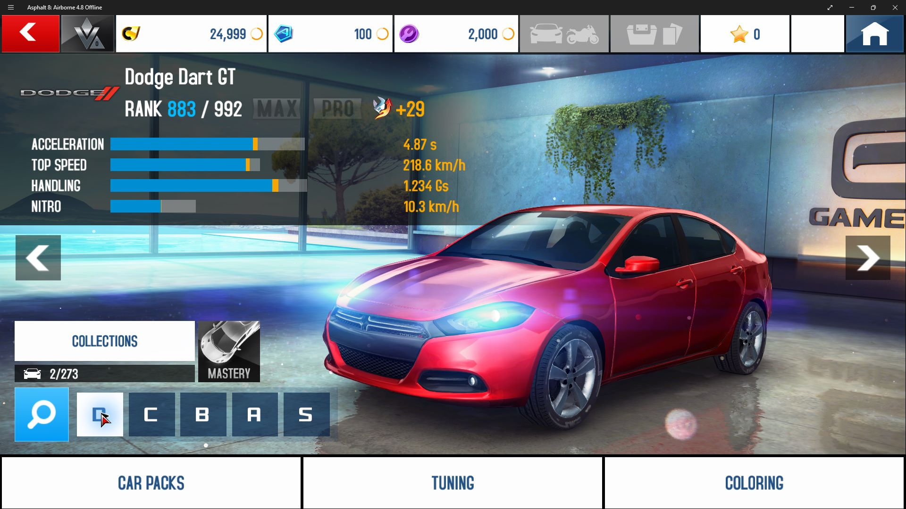
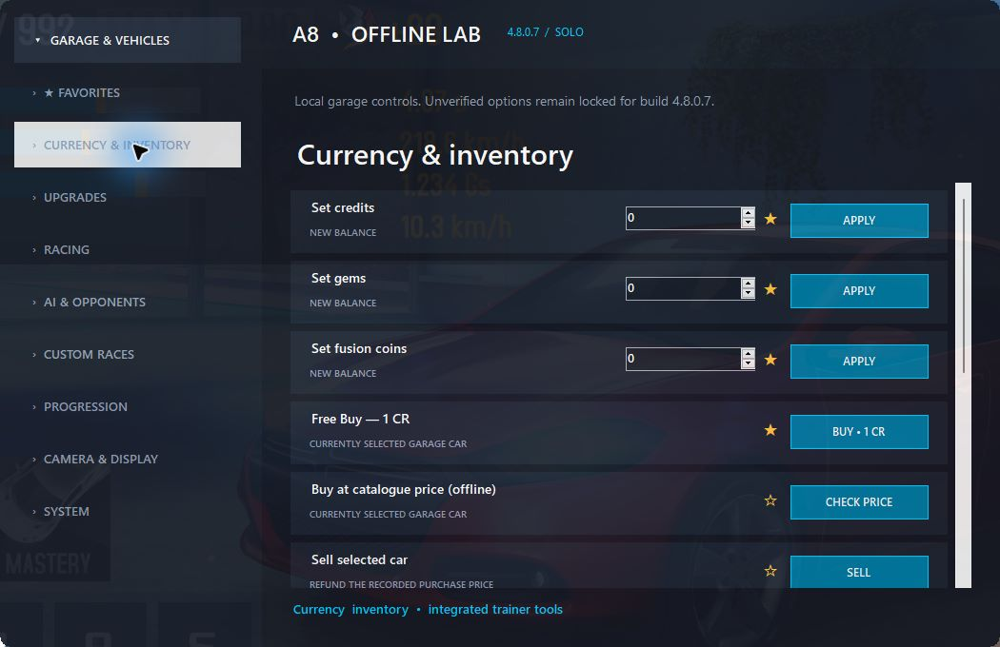
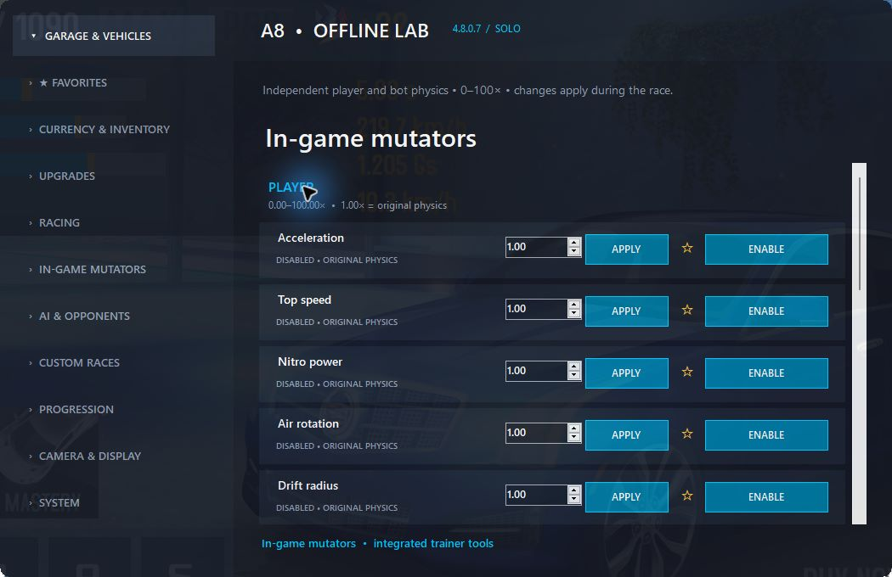
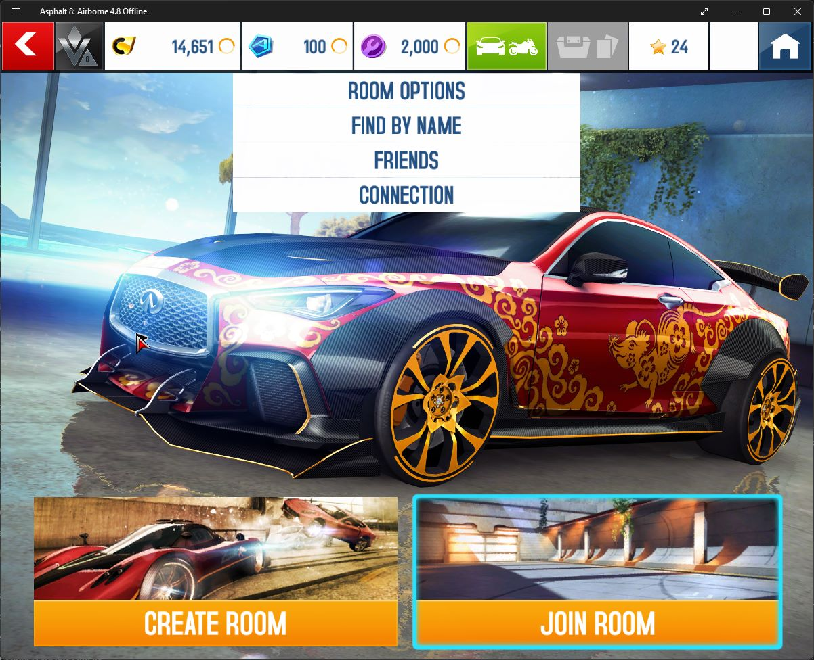

# Asphalt 8 Prime Remake

**An open-source offline launcher and Insert-key trainer for Asphalt 8: Airborne, Windows x86 build 4.8.0.7.**

Keep a local copy of the classic game playable, customize solo races, and manage the garage through a translucent English overlay. The community cheat tables call this release **4.8.0h**; compatibility is checked against the actual executable, rather than the display name alone.

This independent project supports Windows build 4.8.0.7. The MIT license covers the project's code. The GitHub repository provides the source and the manual installer.

## Install with one EXE

1. Download **Asphalt8PrimeRemake-Setup - All-in-One.exe** (2.87 GB) from [MediaFire](https://www.mediafire.com/file/1crlixb526mtglj/Asphalt8PrimeRemake-Setup+-+All-in-One.exe/file).
2. Run the EXE on Windows 11, choose where to create the launcher folder, and approve the Windows administrator prompt. Setup verifies the signed Microsoft x86 framework before installing the game AppX and creating the launcher.
3. Setup opens the game after installation. For later launches, open **Asphalt 8 Prime Remake.exe** from the chosen folder. Press **Insert** for the trainer.

The tested all-in-one EXE has SHA-256 `a466c9654f12faca22487bf4e1411d52e8cd9ac846499ab604ad684f1baa1a99`.

Allow about 10 GB of free space in addition to the download if staging and installation use the same drive. Windows manages the installed game and framework. The folder you choose contains the launcher. The engine stays on 4.8.0.7, and the installer has no automatic updater.

### Windows Sandbox

Use software rendering if the game closes after the Gameloft logo. Save the configuration below as `Asphalt8-Sandbox.wsb`, open it, then copy the installer into the new Sandbox and run it there. A clean installation was tested with this graphics setting. [Microsoft's Sandbox configuration guide](https://learn.microsoft.com/en-us/windows/security/application-security/application-isolation/windows-sandbox/windows-sandbox-configure-using-wsb-file)

```xml
<Configuration>
  <VGpu>Disable</VGpu>
</Configuration>
```

### Manual setup

If you already have a compatible 4.8.0h (4.8.0.7) Windows game package, you can use **Asphalt8PrimeRemake-Setup.exe** from the [GitHub release](https://github.com/nuppii/asphalt-8-prime-remake/releases/latest). Select the `.appx` or `.msix` file, or its extracted folder, when prompted. To update a copy created by the previous loose-layout setup, select that copy's existing folder to keep its Windows package family and save data. A new packaged installation starts with its own profile.

The installer includes the Classic bot-race and TAB standings hooks. A real Classic race with bots was exercised locally. Clean installation was verified in Windows Sandbox using software rendering. See the [validation results](docs/VALIDATION.md) for test coverage.

## Screenshots

Real captures from the local Windows build, with the game and trainer set to English.










## What it does

**Native multiplayer development:** the Multiplayer tile opens the original in-game Create/Join interface. Added native pages cover Room Options, Find by Name, Friends, Connection and keyboard entry, with saved room names and Default / 1–60 grid and lap settings. The AI-fill setting is linked to the original host control: adding/removing six lobby AI and saved ON/OFF synchronization were verified in the installed build. Other custom native race policies remain requested settings, with enforcement unverified. The optional self-hosted directory supports room-name search, persistent friends, presence and invitation delivery. The managed bridge passes local HTTP tests, and native request acceptance, presence, inbox resolution and dismissal were exercised against an owned local service. Resolving an invitation does not join a native race. No public HTTPS service, cross-PC race, 60-human grid or native race-host migration is established. See [multiplayer implementation status](docs/MULTIPLAYER.md).

Native directory publication and **JOIN SELECTED** are now connected to the original game browser. A clean installed session automatically advertised its actual public room and UDP lobby port to an owned loopback directory; leaving the room withdrew the listing. Native UDP rooms and prototype TCP rooms are explicitly distinguished. A controlled nonresponding fixture exercised the enabled join action and browser entry without a crash. **No native peer connection or Internet race was established.** The separate **JOIN BY IPV4 ADDRESS** action still works without a directory. No public service, NAT fix, 60-human support or native race migration is established; see [player-hosted Internet work](docs/INTERNET-HOSTING.md).

- Launches the registered offline game from one executable.
- Shows or hides a dark translucent mod menu with **Insert**, with categorized tools and starred favorites.
- Remembers enabled tools and numeric settings across menu navigation and game restarts.
- Migrates settings and favorites created by the earlier French interface.
- Applies version-specific native patches only after checking expected bytes.
- Supports independent custom lap and racer settings, with a procedural starting grid and randomized player position.
- Adjusts seven live physics multipliers independently for the player and bots, with individual toggles and group resets.
- Provides local wallet, purchase, sale, booster, tuning and career controls.

### Menu sections

| Section | Controls |
| --- | --- |
| Garage & Vehicles | Career class/required-car override, all-car preview, hidden catalogue entries, texture patch |
| Favorites | Shortcuts to starred tools and their original sections |
| Currency & Inventory | Set credits, gems and fusion coins; catalogue-price or 1 CR purchases; receipt-based sales; booster toggles and timers |
| Upgrades | Offline PRO purchase path, MAX/PRO overlays, R&D tuning and decal preview |
| Racing | Nitro tools, finish patches, crash behavior, race timer, speed/drift modifiers and collision behavior |
| In-Game Mutators | Separate player/bot acceleration, top speed, nitro power, air rotation, drift radius, steering and braking multipliers |
| AI & Opponents | Automatic driver, AI finish, stopped vehicles, traffic and ghost behavior |
| Custom Races | Lap count, racer count and additional Quick Race track entries |
| Progression | Career/Moto Blitz access, driver name, mastery, R&D and event-related patches |
| Camera & Display | HUD, vehicle visibility, seasonal tracks and visual effects |
| System | Patch engine status |

See [the complete feature catalogue](docs/FEATURES.md) for tool names and important distinctions.

## Source build requirements

- Windows with support for the original x86 UWP game and loose package registration.
- Your own complete Windows **4.8.0.7** game folder, including its data, assets and manifest, to install and play.
- Python 3 for the offline executable patch script.
- Visual Studio C++ Build Tools with the **x86** MSVC compiler/linker.
- Windows .NET Framework 4.x C# compiler and WinForms assemblies.
- The game's x86 `Microsoft.VCLibs.120.00` runtime dependency.

The accepted original `Asphalt8.exe` SHA-256 is:

```text
6a5d3933f92809297631f1299c9906ec40fbb9d585a8c77115f321bfe733134c
```

Other releases, Android builds and newer game versions are unsupported. The installer preserves an original executable and manifest before patching the selected copy.

## Build from source

To reproduce the release installer, install PyInstaller in the build Python environment, then run:

```powershell
.\scripts\Build-Setup.ps1 -MsvcBin '<your x86 MSVC compiler directory>'
```

The build downloads and verifies the unmodified Microsoft framework package. Pass `-RuntimeAppx '<path to the signed x86 framework AppX>'` to supply an existing copy. The executable goes to `build/release` by default. The build does not read or embed a game package. The independent developer installer below uses loose registration and can build and patch an extracted copy directly. [Microsoft's framework redistribution information](https://learn.microsoft.com/en-us/visualstudio/productinfo/2015-redistribution-vs)

1. Copy your complete compatible game into a dedicated directory. Keep your original installation and a backup of your local save.
2. Clone this repository and open PowerShell in its root.
3. Run the installer against that dedicated game copy, using your installed **Hostx86\x86** compiler directory.

```powershell
.\scripts\Install-Offline.ps1 `
  -GameDirectory 'D:\Games\Asphalt 8 Prime Remake' `
  -MsvcBin 'C:\Program Files (x86)\Microsoft Visual Studio\18\BuildTools\VC\Tools\MSVC\14.50.35717\bin\Hostx86\x86'
```

The MSVC path above is an example from the development machine; adjust it to your installation. Loose package registration must already be permitted by Windows. The script does not change Windows security settings or install runtime dependencies automatically.

The resulting launcher is placed directly in the selected game folder:

```text
Asphalt 8 Prime Remake.exe
```

Launch that executable and press **Insert**. You can create a Windows shortcut to it. The tray menu also exposes **Show / hide**, **Launch game** and **Exit trainer**.

The offline Windows registration revision is 4.8.0.10. The engine is still the supported 4.8.0.7 build. Existing installations retain their Windows package family and save data.

For an already registered offline copy, build just the trainer:

```powershell
.\trainer\Build-Trainer.ps1 `
  -MsvcBin '<your Hostx86\x86 directory>' `
  -Output 'D:\Games\Asphalt 8 Prime Remake\Asphalt 8 Prime Remake.exe'
```

Close the game and existing trainer before replacing the launcher. Restart the game after an update so the new trainer starts from original in-memory bytes.

Use the full installer when upgrading to the native multiplayer controls. It generates the local panel, keyboard, and waiting-room roster resources and archives the former launcher name. Building the trainer alone does not create those resources.

## Using the trainer

### In-Game Mutators

The **Player** and **Bots** groups expose the same seven controls. Each starts disabled at **1.00×** and accepts **0.00–100.00×**. Set a multiplier, click **Apply**, and use **Enable/Disable** for that individual effect. Applied changes take effect during the running race. The small **Reset player** and **Reset bots** buttons beneath their groups disable that group's effects and return its multipliers to 1.00×.

| Control | Effect |
| --- | --- |
| Acceleration | Engine force gain |
| Top speed | Native speed cap multiplier |
| Nitro power | Nitro boost force; nitro capacity is unchanged |
| Air rotation | Angular velocity while every wheel is airborne, affecting rolls and spins |
| Drift radius | Inverse gain on the game's drift yaw assistance; an approximate turning-radius control rather than a distance in meters |
| Steering response | Steering angle gain |
| Braking | Braking force gain |

Values below 1 reduce the directly scaled quantities; smaller drift-radius factors instead produce tighter assisted turns. Large gains can make a car difficult to control. A zero top-speed multiplier uses a small **0.01 native-unit** cap to avoid division by zero. Drift radius also uses a minimum factor of 0.01 and clamps its assisted yaw angle to ±π. These bounds keep the native calculations finite.

Mutators operate on live per-car physics and leave saved tuning unchanged. Air rotation removes the previous frame's gain before applying the current one, preventing exponential accumulation. Settings and enabled states are retained in `mutators.txt`; **Reset** provides a quick return to normal physics without editing that file. See [the validation notes](docs/VALIDATION.md) for the tested combinations.

### Custom races

Set **Lap count** and **Racer count**, click **Apply**, and enable each override independently. Racer count includes the player: **61 means you plus 60 opponents**. The UI allows 1–999,999 laps and 1–61 racers. These are input bounds, not a claim that every value has completed a full race.

Settings apply to the next race start. Changing a value during an ongoing race does not rebuild that race. Disabling an override restores that event's own value for the next start. The native grid builder extends the starting formation and randomizes the player's grid position.

### Career access

**Ignore class and required car** and **Unlock all career seasons and Moto Blitz** operate the same combined access override. While enabled, a compatible owned garage car can be selected for events that normally require another class or specific car. This does not permanently purchase the required vehicle or award career stars. Disabling restores the normal selection restrictions; reopen season lists where needed to refresh their display.

### Wallet and purchases

**Set credits**, **Set gems** and **Set fusion coins** replace the respective balance with the entered amount. They do not add that amount. These are persistent save changes.

**Free Buy — 1 CR** buys the selected car for one credit through the local purchase command. **Buy at catalogue price (offline)** reads a native credit or gem price before confirmation. A car without a usable price in the loaded catalogue is rejected with a message; the project does not invent prices for missing catalogue data.

Sales refund the amount recorded by this trainer when the car was purchased. Cars without a receipt cannot be reliably refunded. The starter Dodge Dart GT remains in the garage. Selling removes that car's upgrades as part of removing its ownership.

### Upgrades and boosters

MAX/PRO tools are runtime tuning overlays. Turning them off is intended to reveal the underlying saved tuning. Paid native upgrades, car purchases, wallet edits and earned rewards change the save permanently and are not undone by disabling an overlay.

The offline PRO purchase path uses the game's fusion cost. Server-provided card inventory is unavailable offline. Four separate unlimited booster toggles cover double credits, nitro starter, tuning kit and extra tank.

For **Driver name**, submit a valid name and then open a car's tuning screen to apply the queued change.

### Language and state

The trainer interface is English. Set the game to **Settings → Language and Country/Region → English**. The game retains its own language preference separately.

State is stored beneath the game folder in `_offline_patch_backup/tools/`:

| File | Purpose |
| --- | --- |
| `active-tools.txt` | Enabled tools and numeric values |
| `mutators.txt` | Separate player/bot multipliers and enabled states |
| `favorites.txt` | Favorite tool names and section destinations |
| `car-receipts.txt` | Recorded purchase prices for refunds |
| `trainer.log` | Local diagnostics |

Save data belongs to the registered Windows package's `LocalState` folder. See [architecture and recovery](docs/ARCHITECTURE.md).

## Validation and limitations

This project has been exercised on the local Windows installation. Recent observed career starts include a class C Infection event with the class D Audi R8 e-tron, a Renault Clio-restricted event with a class D Dodge Dart GT, and a class B Great Wall event with the Dodge. Those runs displayed **5 laps and 40 racers**. Class and required-car restrictions were also checked by toggling the override on and off in the same garage screen.

The English build compiles successfully, and the game language survives a restart. Screenshots document the visible English UI. Ported signatures and compilation do **not** establish that every cheat works correctly in every event or with every car. Full race completion across all tracks, 61-racer endurance, every MAX/PRO combination, every Moto Blitz gate, and all server-dependent event paths remain broader regression work.

The mutator checks include a compiled native fixture, live player/bot measurements in an eight-car Sector 8 race with the Audi R8 e-tron, player UI enable/reset, and zero/100× airborne rotation samples. No game crash was observed during those checks. This does not establish coverage for every car, track, or 61-racer combination.

Multiplayer, daily tasks, remote events, store downloads and server rewards may remain unavailable or display loading indicators. Unlocking a local UI gate does not restore an online service. Consult [validation notes](docs/VALIDATION.md) before reporting an issue.

## Troubleshooting

- **Unexpected signature** — confirm the exact supported executable, close duplicate trainers, and restart the game. Do not force a patch into a mismatched build.
- **Game not found** — start the registered offline copy and allow it to initialize.
- **Purchase pending** — open an in-game menu so the game's UI thread can process the queued command. Read the trainer's resulting status before retrying.
- **No catalogue price** — the loaded data contains no usable offline price for that car.
- **Original restrictions still visible** — reopen Play or the season list; verify the combined career override state.
- **Package registration fails** — check loose registration support and the x86 Visual C++ runtime dependency.
- **Build output disappears** — inspect your security product's report and review the source/build provenance. This trainer writes to the game's process; no antivirus bypass or obfuscation is included.

## Project layout

```text
trainer/                  WinForms launcher, patch engine, native grid and mutators
scripts/Install-Offline.ps1
scripts/patch_offline.py   Version-checked local executable/manifest patcher
docs/FEATURES.md           Menu tool catalogue
docs/ARCHITECTURE.md       Runtime design, persistence and recovery
docs/VALIDATION.md         Observed checks and remaining coverage
docs/images/              Real English UI screenshots
```

## Credits and contributions

Community reference tables: **ZAJEC HAX GAMES (2020)** and **cezar**, for the Asphalt 8 v4.8.0h cheat tables. Their original tables are not bundled. The project integrates native ports and subsequent offline-specific changes into the existing menu sections.

Asphalt 8: Airborne, game content and associated trademarks belong to Gameloft and their respective owners. This project is unofficial and unaffiliated with Gameloft. See [NOTICE](NOTICE) for licensing scope.

Please submit English issue reports with the executable version/hash, event and car, enabled tools, reproduction steps and expected/actual behavior. Keep save files and logs containing personal information out of public reports. Contributions should preserve signature checks and include an in-game regression description for changed hooks.
