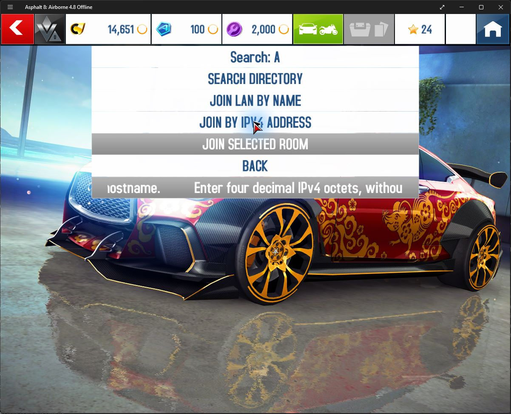
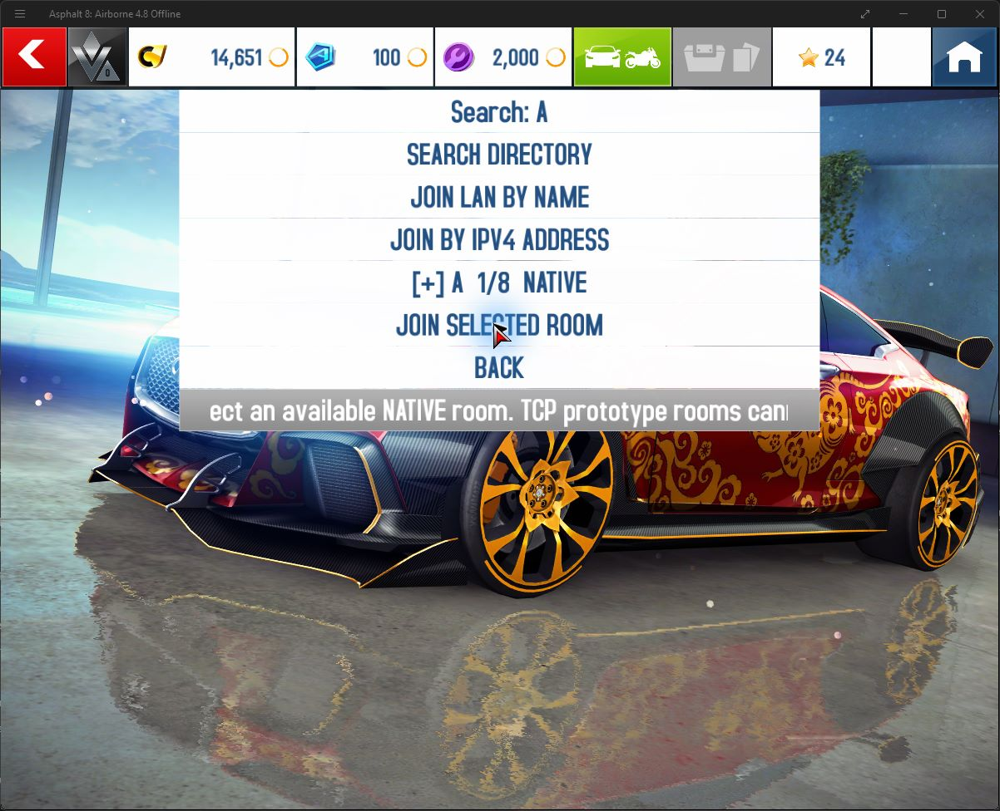

# Player-hosted Internet races

The intended race server is the current player's PC. A dedicated game server or rented VPS is not a prerequisite. On a graceful host change, the race must pause, transfer to another player's PC and resume from the acknowledged state. Changing a label or transferring the experimental TCP lobby does not satisfy this requirement.

**Current limit:** the opt-in Internet host mode requests fixed UDP ports so a reachable IPv4 router can forward the original game protocol. The port hooks have passed isolated checks. A native peer connection, Internet race, and race-host migration still require separate validation.

## Discovery and hosting are separate

Direct address / invitation connections must work without the optional directory. A directory can list public rooms and resolve names, but never owns the simulation. The existing directory remains optional; no public service has been deployed or made mandatory.

As a local comparison, the installed Unreal Tournament configuration includes player-hosted networking and several `UdpServerUplink` / `ListFactories` master-server entries. Those entries advertise/find servers; they are not evidence that a third-party machine hosts a player's match or that UT's race/state migration exists in Asphalt.

Without an external directory, share the host's reachable public IPv4 address. Room-name search uses a configured directory. Direct hosting requires inbound UDP reachability to the host, which may depend on the network operator. The installer updates the game's declared networking capabilities. The launcher does not edit router or firewall rules.

In **Multiplayer → Find by Name**, leave the search field empty and select **Search Directory** to browse active public listings. Enter the beginning of a room name to filter the results. The arrows are labelled **Previous Page** and **Next Page**. The listing shows occupancy and host ping in milliseconds. Host ping measures the IPv4 ICMP round trip from the browsing PC. If the host or its router does not answer, the row shows `-- ms`. A measured value does not establish that the lobby or race UDP ports are reachable.

The native password build adds an original Asphalt padlock beside protected directory rows. The host sets **Edit Private Password**, enables **Private Room**, and creates a room. A configured directory publishes the room once the host's password hooks and session key are ready. Guests set **Set Join Password** in **Find by Name**, then select the listed room or use **Join by IPv4 Address**. Native host admission checks the join proof in both cases. The password stays session-only. The directory stores the protection flag and protocol version. The players use the same UDP ports as public rooms.

The native password proof is bound to the room, player identity and a short-lived timestamp and nonce. The two PCs need synchronized clocks. The proof is not a password-authenticated encrypted channel. An observer with a capture can test password guesses offline, so use a distinct room password. The isolated runner exercises the generated send and admission callbacks, but two-instance game networking and in-game visual validation are still pending.

Hold **TAB** in a supported race to request the native standings. Classic, Battle and Infected use the hooked original sorter. The host copies its measured game-transport RTT for each connected driver. The host row displays **HOST**, AI rows omit ping, and unavailable samples display `-- ms`. Every guest receives the same host-measured table.

Guests retrieve the table directly from the host trainer over **TCP 6540**. Internet hosts behind NAT need this TCP port forwarded for guest standings, in addition to the existing UDP game ports. The tracker opens the read-only TCP listener while a current native race snapshot is available. Private rooms require a password proof for this channel too. No directory service is involved in relaying race data. The native renderer and two-peer in-game behavior still require live validation.

## Test on two Internet connections

1. Install from this revision with `scripts/Install-Offline.ps1`. The installer keeps the game executable at 4.8.0.7 and registers package revision 4.8.0.9 with inbound Internet capability. The host and guest need the compatible game installation. Use the current launcher on both.
2. On the host's router, forward **UDP 6529, 6530 and 6540** to the host PC's LAN IPv4 address, preserving the port numbers. The discovery listener uses 6529, lobby admission uses 6530, and the race server requests 6540. A host with a directly reachable IPv4 address can skip router forwarding. Carrier-grade NAT or a second upstream NAT can prevent these forwards from being reachable.
3. Close any existing game and trainer on the host, then run `& '.\Asphalt 8 Airborne 4.8.exe' --internet-host` in PowerShell from the game folder. Create a public Classic room and enable AI fill. The launcher log records whether the bind hooks were activated. The normal launch keeps the game's original port selection.
4. On the second Internet connection, open **Multiplayer → Find by Name**. Enter the host's public IPv4 address and select **Join by IPv4 Address**. With a configured directory on both sides, search for the room name and select its native listing instead. Check that both games show the same two human players before launching.
5. Start the race from the host. Check the start and the same human and AI grid on both games, then drive both cars and verify that their motion is synchronized. The port changes do not implement bot takeover during a running race.

Hosting mode preserves the original packet format and admission flow. Both signature-checked bind hooks must install before the fixed requests are enabled. The directory advertises only the actual lobby port reported by the game and suppresses publication in this mode if that port differs from 6530. A published listing does not test the router or establish race connectivity.

The reference protocols are [STUN (RFC 8489)](https://www.rfc-editor.org/rfc/rfc8489.html) for observed UDP endpoints and [ICE (RFC 8445)](https://www.rfc-editor.org/rfc/rfc8445) for candidate exchange and connectivity checks. Relay fallback is a separate, optional infrastructure decision; STUN alone is not a relay, peer authentication or a guarantee of Internet connectivity.

## Implemented UDP foundation

`multiplayer/StunBinding.cs` implements an unauthenticated STUN Binding subset for IPv4 and IPv6. It creates a cryptographically random transaction, decodes XOR-MAPPED-ADDRESS, checks the optional FINGERPRINT, rejects unknown required attributes and rejects integrity attributes that this subset cannot verify. Responses must match both the transaction and the explicitly selected server endpoint. Retransmissions keep the same socket and transaction; timeouts are bounded and the caller's receive timeout is restored.

The API accepts a caller-owned socket because a public mapping belongs to that socket. Its synchronous probe requires exclusive receive ownership: it must not be called concurrently with the game's receiver. A later native transport adapter needs a shared receive dispatcher, or an explicit native probing phase, rather than consuming gameplay packets through this diagnostic API.

Build and run the local fixture:

```powershell
.\multiplayer\Build-Rooms.ps1
.\build\multiplayer\InternetCheck.exe selftest
```

For a deliberately selected STUN service, the diagnostic accepts an explicit IP and port:

```text
InternetCheck.exe stun <server-IP> <port>
```

No public provider is selected or contacted automatically. The diagnostic owns its own temporary socket; its result is **not** the native game's endpoint. It neither publishes that result as a room nor changes the game's native connection status.

The local fixture checks IPv4/IPv6 decoding, all truncation lengths of both sample packets, transaction mismatch, unknown required attributes, an independently generated CRC fixture and tampering, retransmission from the same socket, rejection of a wrong-source packet, rejection of a wrong transaction, timeout and receive-timeout restoration. It also exercises 1,000 arbitrary bounded attribute streams. These are protocol and socket checks, not cross-PC race tests.

## Native direct IPv4 discovery

The installed native **Find by Name** page now also contains **JOIN BY IPV4 ADDRESS**. Edit the Search field with a four-octet IPv4 address, confirm, then choose that action. Confirmation only edits the field; directory search requires its explicit button. No directory URL is needed for the direct action. The button is enabled only when the targeted native discovery hook is installed.

Only the current native browser Finder uses the explicit destination on UDP 6529. Results must have the requested observed IPv4 sender, a native room identity, and a reported lobby port. The original Join callback is used for a unique match. Multiple matches remain a manual browser choice. Leaving the browser, invalid input, or reaching the 900-UI-tick bound restores default discovery. Dispatch also ends directed discovery and waits for the native lobby to acknowledge the same room identity and port.

The compiled x86 fixture exercises the actual generated wrapper and native helper in owned memory, with stubs for original game callbacks: address parsing and encoding, active versus default discovery, foreign-Finder fallback, cancellation and expiry. A clean installed game session without Frida verified the visible enabled action, native keyboard confirmation, and rejection of empty/invalid input. These checks do **not** establish that a remote host responded, that a native peer joined or that an Internet race ran.



Discovery alone is insufficient through many routers. The game advertises the bound lobby port at Room+0x78 and the bound race port at Room+0x7A after the native server starts. The fixed bind requests make the manual forwarding rules available before startup. Automatic router mapping and native hole punching remain unimplemented.

## Native directory publication and selected joining

The configured directory now receives automatic announcements from a real public native host. Listings carry `transport: "asphalt480-udp"`, a 16-hex native room ID, `discoveryPort: 6529` and the observed native UDP lobby `port`. A separate random directory ID owns the lease. Prototype `room-control-tcp` entries remain explicitly incompatible with native joining. Leaving a host room, making it private or clearing the directory configuration withdraws publication.

Join Selected freshly resolves the listing, verifies native transport/identity, IPv4 endpoint, real lobby port and free capacity, then queues a sequence-acknowledged native request. Directed discovery targets the selected host. Responses must match the native room ID, lobby port and observed sender IPv4 before the original native Join callback is invoked. Connected requires a live, accepted client lobby matching the target; browser entry alone never establishes it.

The clean installed build on 20 November advertised its real **ASPHALT8** room as `1/8`, native ID `f968940900000001`, UDP lobby `54551` and discovery `6529`. Windows confirmed the game's ownership of both UDP endpoints, and leaving removed the announcement. This used an owned temporary directory at `127.0.0.1:47785`; no public HTTPS directory was chosen or deployed. A separate nonresponding fixture named **A** exercised Join Selected and opened the browser without a crash. No native peer connection followed.



The latest local checks passed 23 Python integration tests and an isolated native fixture with 1,521 assertions and 683 relocations. Original game APIs are stubbed in that fixture. These checks cover metadata, preflight, command publication and acceptance guards, not real network delivery or Internet reachability. The earlier two-app same-machine discovery failure remains unresolved; publication does not bypass app-container isolation or router policy.

## Native work still required

1. Validate the new directed discovery against a real remote native host, including response selection and original eligibility checks.
2. Validate the fixed lobby and race binds and synchronized driving across the forwarded network path.
3. Check peer reachability on the exact sockets used for gameplay before declaring a room join successful. UDP endpoint observations cannot describe the separate experimental TCP room listener.
4. During handover, pause at an authoritative tick and transfer the map/event, cars and tuning, positions and velocities, laps/checkpoints, race clock, results, bot state and applicable random state.
5. Start the successor's native server on its own PC, establish its reachable route, import the checkpoint and obtain acknowledgements from the surviving players before resuming under a new authority epoch.
6. Handle a failed successor without resuming two authorities; handle abrupt host loss only once usable checkpoints are replicated in advance.

The current native server rejects more than 12 participants and contains fixed-size structures. The standalone 60-racer solo patch does not lift this network limit. Native Internet joining remains unverified; race checkpoint import, synchronized resumption and race-host migration remain unimplemented. No Internet-ready room status is enabled by the UDP helper or directed discovery.
