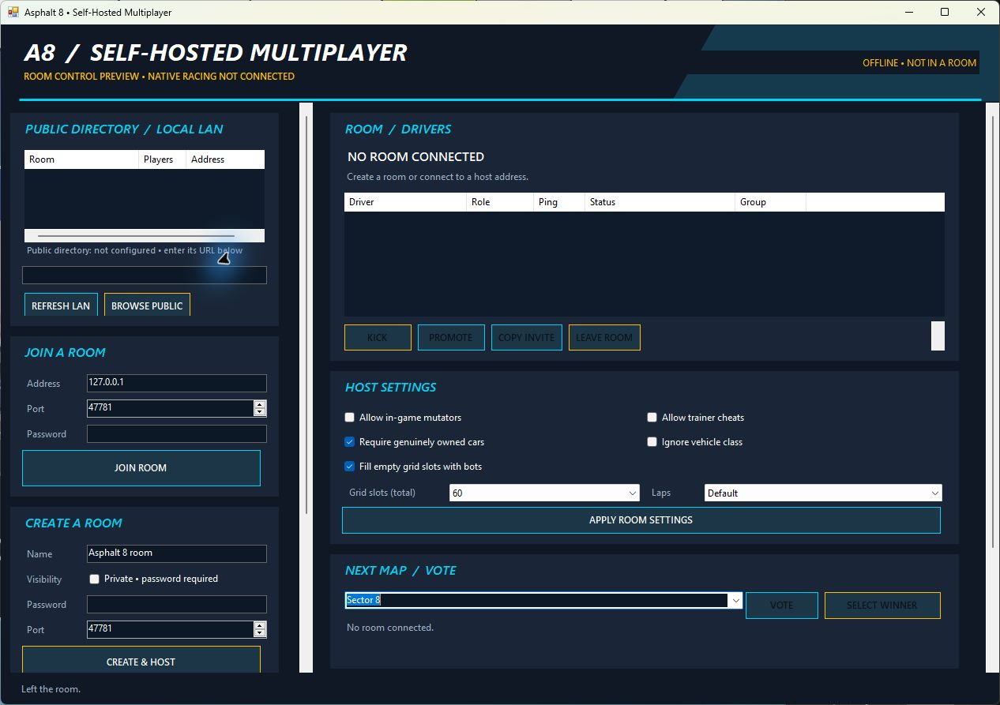

# Self-hosted multiplayer: implementation status

This branch contains a working room-control service and a companion interface. **It does not yet provide synchronized playable multiplayer races.** The interface keeps Start Race disabled while `RaceBridgeReady` is false. A room participant count or bot-fill estimate is not evidence of spawned network cars.



## Implemented control plane

- A host automatically starts a TCP room server when creating a room.
- Public LAN discovery and direct address/port connections.
- Private-room password challenge authentication; passwords are not sent in clear text.
- Nicknames, status text, connected member lists and measured host RTT.
- Host settings for mutators, cheats, owned cars, class restrictions, bot fill, grid size and lap count.
- **Default**, followed by **1–60**, for grid size and laps. Default currently uses eight room slots while native event-default resolution is pending.
- Planned bot fill is `max(0, effective grid slots - human members)` when enabled. For example, 40 slots and 20 humans produces an estimate of 20 bots. No native bots are spawned by the room service yet.
- One map vote per member, deterministic tie resolution, moderator promotion, kicking and leaving.
- Clipboard invitations containing the current connection endpoint.
- Graceful **lobby** host handover to the eligible peer with the lowest measured RTT to the departing host, with a deterministic ID tie-break. This measures a specific RTT; it is not a universal assessment of every peer's Internet connection.
- Host handover preserves room/member IDs, settings, selected map, votes and moderator roles. A private session ticket protects migrated member identities.
- An optional public-directory client and a separately deployable directory service. No public deployment is bundled or configured.

Room policy flags are validated and replicated settings. Their enforcement against native gameplay, arbitrary external cheats or unowned native vehicle selection is **not implemented**. The room transport is not encrypted; password challenge authentication must not be described as TLS or a complete anti-cheat system.

## Not implemented or not verified

| Requirement | Current state |
| --- | --- |
| Native race start and vehicle replication | Not connected to the room service |
| 60 human racers | Not supported by the native bridge; explicit native start limit found at 12 |
| Mixed human/bot race spawning | Calculation implemented; native synchronization/spawning pending |
| Mutator/cheat/ownership/class policies in a race | Settings only; native enforcement pending |
| Abrupt host failure recovery | Not implemented |
| Migration during an active race | Not implemented |
| Automatic Internet/NAT traversal | Not implemented; no router/firewall settings are changed |
| Public-directory lease migration | Not verified; a new host cannot assume the departing host's lease |
| Persistent mutual friends and presence across rooms | Not implemented |
| Clans/groups with membership and permissions | Not implemented; profile group tag is cosmetic |
| Public Internet directory deployment | Requires a selected reachable HTTPS deployment |

## Build and test the room service

```powershell
.\multiplayer\Build-Rooms.ps1
.\build\multiplayer\RoomCli.exe selftest
.\build\multiplayer\RoomCli.exe migrationtest
```

The tests start distinct host/client processes on loopback. They cover valid/invalid passwords, room capacity, permissions, voting, profiles, moderator roles, kick/leave, measured RTT and two successive graceful host changes. These are real socket tests, not tests between different physical PCs or across the Internet.

Public-directory API tests:

```powershell
python -m unittest discover -s directory -p test_directory.py -v
python -m unittest discover -s directory -p test_room_integration.py -v
```

An additional local C# integration check exercised UDP public discovery, private discovery exclusion, C# publication into the Python HTTP directory, browsing, lease cleanup and HTTPS URL validation.

The integration check requires the Windows build above and an isolated LAN with no other room advertisers. It also checks an empty LAN scan on Windows, where an ICMP port-unreachable response must not be presented as a failed search.

Manual verification opened the companion interface through the game's Multiplayer tile, created a host through the interface, joined it from a separate CLI client, and applied 60 room slots. Both endpoints reported two humans and 58 planned bots. This verifies replicated room settings; it does not verify a 60-car race.

## Native investigation

The supported binary contains real native Local Wi-Fi, Winsock UDP, network server/client and remote car/bike classes. The legacy Multiplayer callback is RVA `0x84C7F0`; its ranked tile status getter is RVA `0x42F490`. Status 4 enables the native tile button; the replacement click callback queues the companion UI.

Native `NetworkServer::Start`, preferred-image VA `0xD6D200`, rejects participant counts above 12 at `0xD6D2D1–0xD6D2D4`. A server-owned object also contains an inline 16-element array. Changing the comparison alone would be unsafe. The 61-racer solo grid patch does not remove these network constraints.

The next native validation requires two independent compatible game instances to host/join Local Wi-Fi, observe actual discovery and replication traffic, then connect room identities/settings to that transport. Sixty-player support requires a separate memory-layout and serialization audit.

## Directory deployment

See [the directory guide](../directory/README.md). The directory advertises public room endpoints; it does not relay gameplay, open NAT ports, or prove an announced host is reachable. Private rooms are excluded from public discovery. Host addresses are obtained from the HTTP connection rather than an untrusted submitted address.
