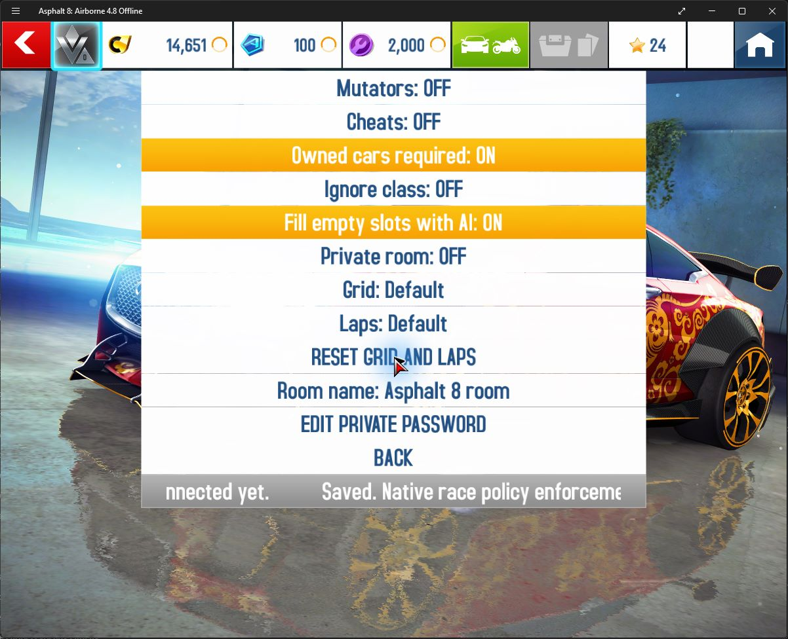
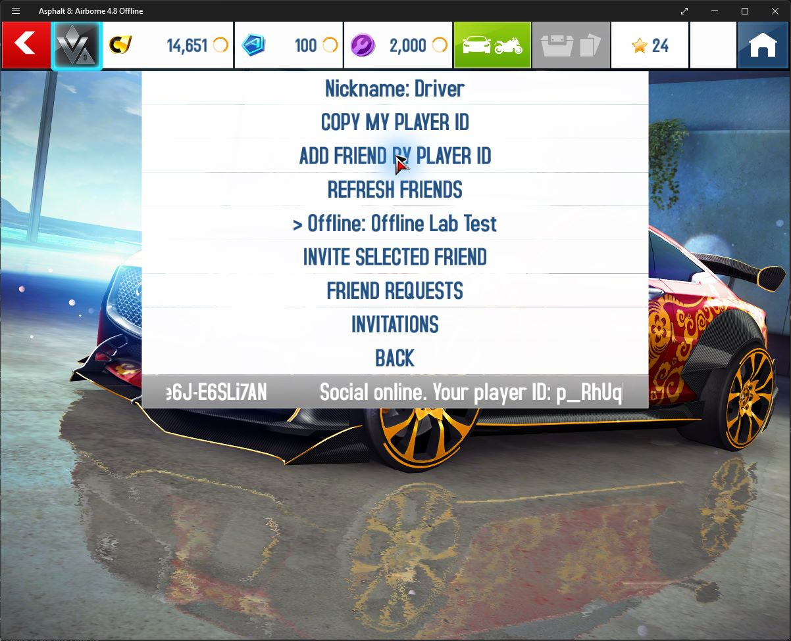
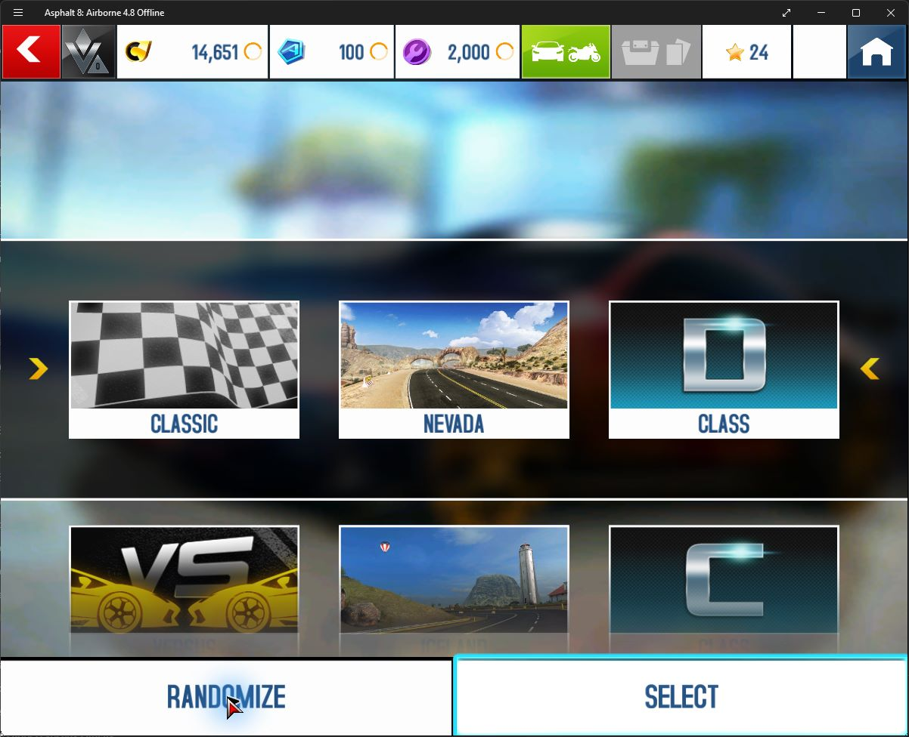
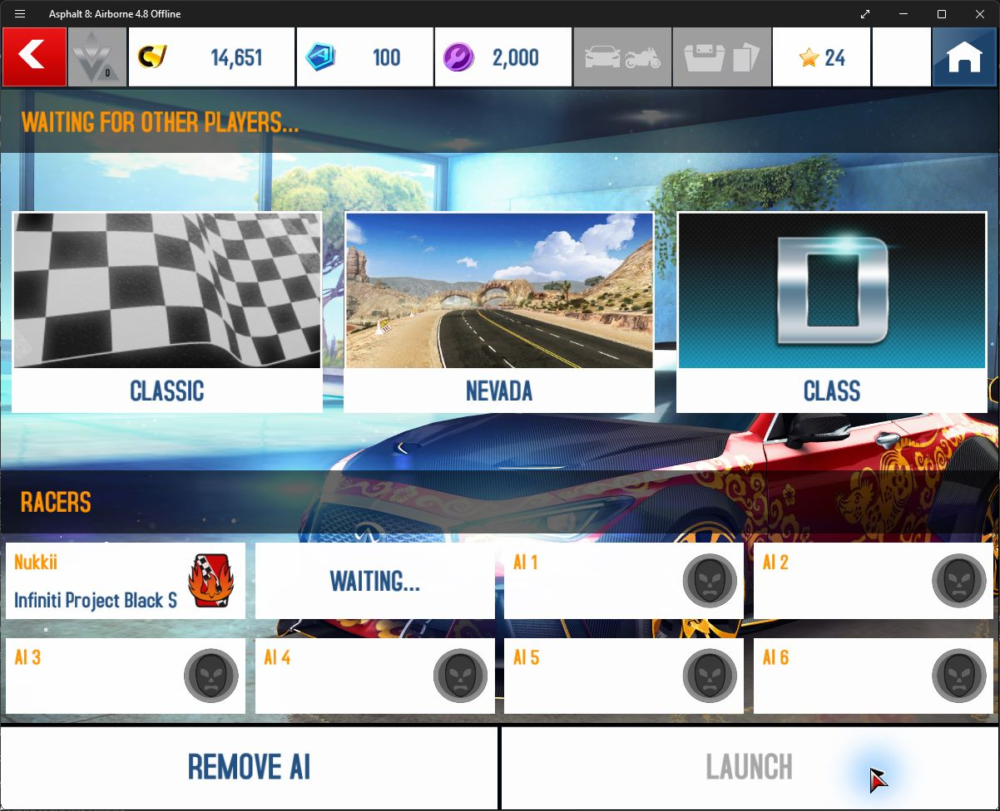
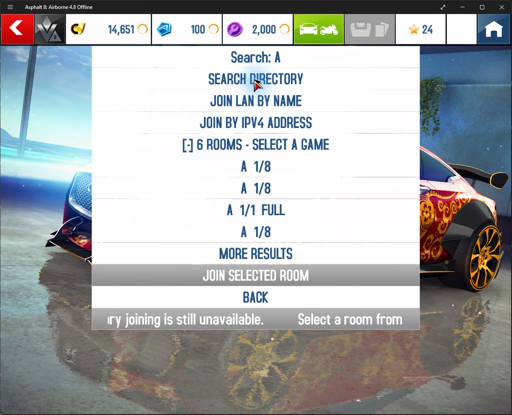
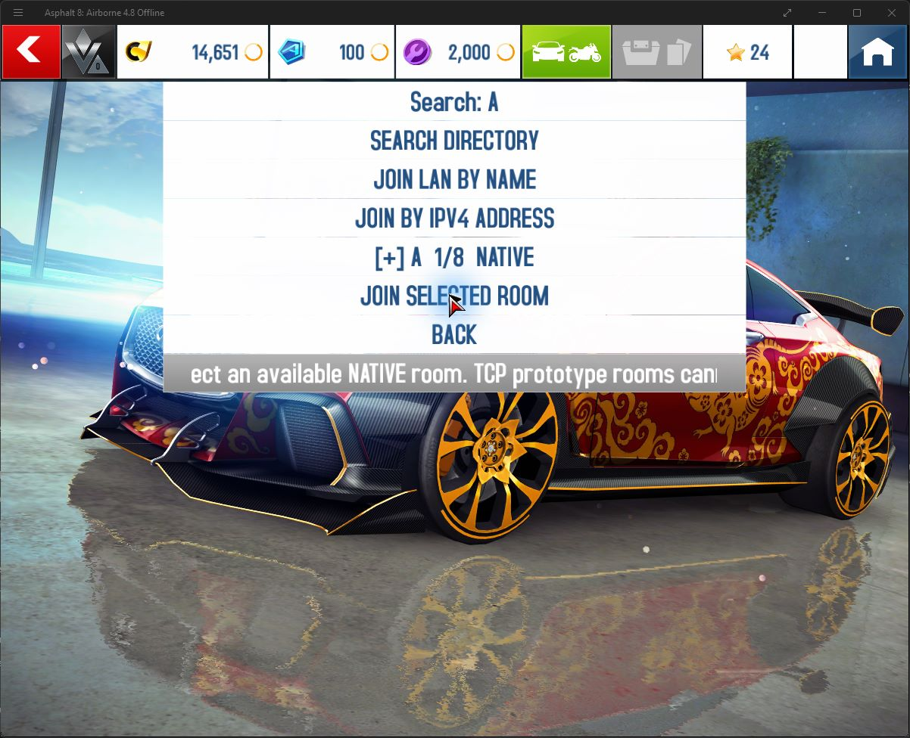

# Native self-hosted multiplayer: implementation status

The Multiplayer tile now opens Asphalt 8's original **in-game** Create Room / Join Room menu. The separate companion window has been removed from the launcher and source. Native menus, typography, garage, circuit selection and illustrations are rendered by the game itself.

Native public-room publication and selected-directory joining are implemented through the original browser. **A native peer connection, synchronized race, Internet reachability and native host migration remain unverified.** Directory publication and browser navigation are separate evidence from an accepted connection.

Additional native pages provide **Room Options**, **Find by Name**, **Friends**, **Connection** and keyboard entry. Room names and requested policies persist locally. Grid and laps use **Default** or **1–60**; Default requests the original event value. A saved setting or visible toggle does not establish native race enforcement.








## Verified native behavior

- Enter the original Local Wi-Fi state from the main Multiplayer tile, skipping obsolete ranked-service gates.
- Navigate Create Room, mode/map/class selection, vehicle selection, boosters and the waiting room.
- Display the original circuit illustrations and native player controls.
- Create a local room: the game process binds UDP discovery port 6529 and additional ephemeral UDP ports.
- Fill and remove AI entries in the waiting room.
- Pass the saved room name into the native `LocalLobbyHost` call; instrumentation observed `Asphalt 8 room` with native capacity eight.
- Open the added main, Room Options, Find by Name and Friends pages in a clean build without Frida attached. The native lowercase keyboard entered literal `a`; Cancel restored the previous value.
- Accept a real incoming request from an owned local test identity: the service recorded one friendship and zero pending requests. The friend row showed Online, then Offline after presence expiry.
- Display a real invitation from that test identity, resolve it with the truthful not-joined status, and dismiss it from the inbox.
- Submit name query `A` to the local HTTP directory and display zero matching rooms.
- Use **JOIN LAN BY NAME** to enter the original `SelectRoom` browser. With no matching room available, the helper reached its bounded 900-tick timeout and Back returned without a crash.

This is a native LAN foundation. Joining from another physical PC, synchronized human driving, automatic native race-host migration, Internet reachability and 60-human grids have not been verified.

A temporary single-human launch experiment reached NetworkManager/NetworkServer start and Nevada loading, then displayed the native **You are alone** dialog. This does not establish a playable synchronized race. The temporary minimum-human change was restored and is not shipped.

## Remaining integration

| Requirement | Current state |
| --- | --- |
| Original in-game menus and map artwork | Installed and manually exercised |
| Native room creation and UDP binding | Observed on the host PC |
| Joining and racing across different PCs | Not verified |
| Directory search by room name | Backend exact/prefix matching and duplicate choices tested; native query `A` produced the service's zero-match result |
| Native public-room publication | Clean installed game advertised its actual room, ID and UDP ports to a local directory; leaving withdrew the lease |
| Native LAN join by name | Original browser entry, bounded timeout and Back observed; successful room joining not verified |
| Native direct IPv4 action | Installed native action and invalid-input handling exercised; scoped directed-discovery helper/wrapper passed an isolated x86 fixture; successful remote discovery/join not verified |
| Room-search dropdown and Join Selected | Expand/collapse, paging and selection exercised; fresh native-room preflight and original-browser dispatch implemented; a nonresponding controlled fixture opened the browser without a crash, with no peer joined |
| Connection URL and keyboard entry | Native controls implemented; saved URL restores and can be cleared |
| Password entry and custom room policies | Native controls implemented; private native authentication and policy enforcement pending |
| Fill with AI policy bridge | Installed build without Frida: ON populated six AI, native Remove AI removed them and saved OFF; restoring ON populated a fresh room |
| Default / 1–60 grid and lap controls | Requested settings persist; lap code passes an isolated x86 fixture; native race behavior remains unverified |
| 60 human racers | Native server start rejects counts above 12; layout has eight visible entries |
| Automatic native race-host migration | Not implemented |
| Abrupt host recovery | Not implemented |
| Persistent friends, presence and invitation delivery | Native request acceptance, Online/Offline presence, invitation display, resolve-only acceptance and dismissal observed against the local service |
| Clans | Not implemented; room group tags are cosmetic |

The solo grid patch does not establish 60-player network support. Native count, memory layout and serialization changes require separate work.

## Two-instance native LAN test

The [explicit-PID harness](../tools/native-lan-test/README.md) was applied successfully to two separately registered UWP identities on one PC. Hook signatures, suspension and x86 thread-context checks passed for both. Actual native Create/Join navigation then worked without a crash. Preparation uses independent `Host` and `Client` resource copies, approximately 3.2 GB each; no game assets are distributed. Source game files and source user data are read-only inputs. An initial app-container resource-access failure with junctions was resolved by real copies. Copied save seeds did not carry progress into the observed new identities: both started fresh with zero currency and one Dodge.

Host and Client had different native player IDs. Host created an eight-slot room and bound UDP 6529. Client multicast discovery to `224.0.0.1:6529` failed with error 10065, confirmed through Frida's call-context `lastError`. An earlier explicit `WSAGetLastError` probe reported zero incorrectly and was discarded. A temporary unicast diagnostic to `127.0.0.1:6529` recorded 21 successful sends, but Host received no discovery packet and no native join occurred. This diagnostic is not a shipped networking solution.

Microsoft describes same-machine Windows-app socket restrictions in [Sockets and network isolation](https://learn.microsoft.com/en-us/windows/uwp/networking/sockets). Network-isolation policy is a plausible explanation, not a confirmed diagnosis of where these packets were dropped. No loopback exemption, firewall rule or other OS networking setting was changed; manual exemption commands were declined. Both isolated games were closed after testing. The production test instance is separate from those copies.

The native Fill with AI bridge invokes the original button callback at preferred image VA `0xE99D10` (RVA `0xA99D10`). After the isolated runtime check, the installed build was restarted and tested without Frida: saved ON populated six AI, the original Remove AI button removed them and persisted OFF, and Room Options showed OFF on return. Restoring ON populated six AI in a fresh room. The original Grid 20, Laps 3 and room name ASPHALT8 were preserved. This targeted behavior does not enforce the other requested policies or expand native human capacity. Launch remains disabled with only one human.



## Native social bridge

The orange in-game editor accepts physical keyboard input and mouse clicks in the same field. Use the arrow keys, Home and End to position the cursor, Backspace or Delete to edit, Ctrl+A to select the text, and Ctrl+V to paste. Enter confirms the field and Escape cancels the edit. Input is captured only while the game is in the foreground and its editor is open.

Find by Name presents directory results in a collapsible native room selector. Search opens the list; selecting an entry collapses it and keeps the selection highlighted when reopened. Up to four rows are shown at once, with More Results for the second group of the eight-result limit. Empty/loading/unavailable/failed searches have distinct labels. New searches and confirmed query edits clear stale results and selection; late responses for an edited query are discarded. Background social checks do not overwrite the search status while this page is visible.

Listings explicitly distinguish `asphalt480-udp` native rooms from `room-control-tcp` prototype rooms. **JOIN SELECTED** is enabled only for eligible native IPv4 listings with a valid nonzero native ID, actual lobby port and available capacity. It freshly resolves the lease and checks identity and selection again before queueing the native command. TCP listings are never passed to the native join adapter, and native listings are rejected by the prototype TCP invitation resolver.





In the clean installed session on 20 November, the real host room **ASPHALT8** automatically published `1/8` humans, native ID `f968940900000001`, lobby UDP port `54551` and discovery port `6529`. Windows UDP endpoint readback confirmed both ports belonged to the game process. Leaving the room removed its advertisement. The directory was a temporary owned service at `127.0.0.1:47785`, not a public Internet service.

A separate controlled listing named **A** had no responding host. Selecting it and choosing Join Selected opened the original browser without a crash. This verifies UI dispatch, not a native join. The adapter uses directed discovery, exact native-ID/lobby-port/sender-IP matching and the original Join callback. It reports Connected only after observing a live accepted native client lobby matching the requested room; opening the browser or invoking Join never sets that status by itself.

Connection configures an optional directory URL. The managed bridge registers an opaque identity, saves separate DPAPI-protected credentials for the current Windows user, and performs registration, presence heartbeats and social requests in the background. A nickname remains a display name; it does not replace the stable player ID.

Friends are added by player ID and require explicit acceptance. Separate native pages expose friends, incoming requests and invitations. The bridge supports request acceptance/rejection, inbox refresh and dismissal. Invitation acceptance currently resolves the room reference and explicitly reports **native race adapter pending; not joined**. Public native invitation delivery still needs room-lease ownership integration; the tested private-reference path requires an accepted friend and an explicitly supplied valid reference. No room or player is fabricated to populate the UI.

The bridge fixture tests the actual managed implementation against a real loopback social service with simulated game shared memory. It covers protected identity persistence, stale-process handling and disposal. A separate clean-build game session without Frida verified the native friend acceptance, presence and invitation actions listed above. These tests used owned local identities, with no external contacts.

The native LAN helper is linked and called before the local-room filter. Its earlier browser-entry and no-match timeout check used one game instance; the later two-identity discovery test is recorded above. Successful joining remains unverified. The final rebuild also kept asynchronous friend rows in their intended order and reset requested grid/lap values from 1 back to Default, with matching saved-profile readback.

## Experimental room-control service

The C# room-control service remains available for development and is **not the native game's race server**. Python `social.py` exposes both the public room directory and persistent social APIs; `server.py` exposes directory routes alone. Directory search and social calls have a managed native-menu adapter, with the verification limits above. Their tests are socket/HTTP tests, not synchronized game-race tests.

Implemented: actual TCP servers created on hosts, password challenge authentication, LAN discovery, direct connections, public-directory publication, names/status/group tags, RTT measurements, room rules, Default/1-60 settings, planned bot counts, map votes, kick, moderator promotion and graceful lobby handover. A group tag is cosmetic; it is not a persistent clan.

Password authentication uses a challenge, but the room transport is not TLS. Policy flags are replicated settings and do not enforce native gameplay or external cheat restrictions.

The handover starts a new listener inside the elected client's process. On another PC that listener would run on that PC. Tests establish two successive transfers between distinct processes **on one PC**. They do not establish cross-machine reachability or race-state transfer.

Known handover gaps: nominee reachability/NAT, per-client reconnect acknowledgements, fallback when a nominee fails, public-directory lease transfer, abrupt host loss, and authoritative race checkpoints. Lowest RTT to the departing host is the current election metric, not a complete measurement of connection quality.

## Build and validation

```powershell
.\multiplayer\Build-NativeBridgeCheck.ps1
.\trainer\Test-NativePayload.ps1 -TrainerPath '.\build\trainer-native-lobby-controls.exe'
.\build\multiplayer\RoomCli.exe selftest
.\build\multiplayer\RoomCli.exe migrationtest
.\build\multiplayer\InviteCheck.exe selftest
python -m unittest discover -s directory -p 'test_*.py' -v
```

The build compiles the library and test executables, including the exact managed native bridge with a shared-memory test fixture. Tests cover authentication, capacity, authorization, profiles, RTT, voting, promotion, kick/leave, defaults, bot-count calculations, two lobby transfers, directory leases, name-search ambiguity, public/private LAN discovery and English network errors. The Python suite starts loopback fixtures and invokes `InviteCheck.exe`, `SocialCheck.exe` and `NativeBridgeCheck.exe` for real HTTP integration. Social checks cover mutual acceptance, request rejection, inbox isolation, invitation delivery, expiry, persistence and protected client credentials. The discovery integration requires Windows and an isolated LAN with no other room advertisers. These tests do not message external contacts or deploy a service.

The latest recorded checks passed 23 directory/social Python integration tests. The native bridge fixture covers queued native commands, incompatible TCP refusal, lease expiry, actual-host publication and private-room withdrawal. Earlier room selftest, lobby migration, invitation selftest and six native-resource checks also passed. These results do not establish a synchronized native race.

The latest compiled native payload passed an isolated x86 fixture with 1,521 assertions and 683 relocations, including transport observation and selected-join paths with original game APIs stubbed. The fixture runs only in its own allocated memory and never opens the game process. It does not validate peer reachability or race synchronization; the clean installed-build checks above establish the narrower host-publication, UI-dispatch and AI-fill behaviors.

## Native implementation evidence

Supported original executable SHA-256: `6a5d3933f92809297631f1299c9906ec40fbb9d585a8c77115f321bfe733134c`.

The Multiplayer callback is RVA `0x84C7F0`; ranked tile getter is RVA `0x42F490`. Forced status 4 enables the native tile. The replacement callback preserves the existing GS_Play navigation frame, native ownership and cleanup, changes the state enum to `0x25`, and calls Local Wi-Fi factory VA `0xCDB7D0`. Image pointers and external relative calls are relocated into the injected callback.

Runtime instrumentation observed the factory, layout, LocalLobby initialization and create call. The host process bound UDP 6529 and four ephemeral sockets. A temporary launch experiment observed native server start and successful Winsock binds, followed by the unsupported single-human condition described above. The instrumentation was detached and its temporary launch change restored. The installed launcher is verified separately after restart.

Room-name instrumentation additionally observed the actual native host argument `Asphalt 8 room` and capacity eight. The requested-laps hook targets native `ClassicLaps`, but has not yet been verified at runtime. Neither observation establishes custom network capacity or synchronized race behavior.

Native NetworkServer::Start VA `0xD6D200` rejects more than 12 participants at `0xD6D2D1-0xD6D2D4`; another server-owned object has an inline 16-element array. Raising the comparison alone is unsafe.

See [native UI resource research](NATIVE-MULTIPLAYER-RESEARCH.md) for original screen and artwork references. No extracted game artwork or complete game binaries are distributed.

## Hosting and migration work

The target is a player-hosted race, with no mandatory dedicated server or VPS. Direct address/invitation joining must remain independent of the optional public directory. See [player-hosted Internet races](INTERNET-HOSTING.md) for the connectivity boundary, the new bounded STUN socket diagnostic and the native pause/transfer/resume requirements. The diagnostic is not connected to game sockets and does not enable Internet-ready room status.

The public directory only advertises room endpoints. It does not host gameplay, open router ports or relay traffic. Deployment still needs a selected reachable HTTPS host; see [the directory guide](../directory/README.md).

Native race handover must transfer an authoritative checkpoint, open and verify the successor's endpoints, reconnect peers, acknowledge the imported checkpoint and new authority epoch, transfer directory ownership, then close the old authority. Abrupt recovery additionally needs continuously replicated checkpoints and protection against competing hosts. None of this can be inferred from a changed host label or a migrated TCP lobby.
