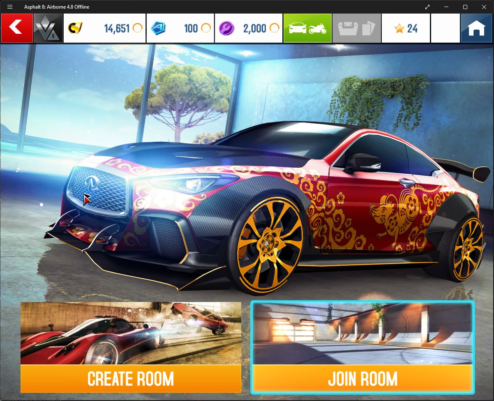

# Native self-hosted multiplayer: implementation status

The Multiplayer tile now opens Asphalt 8's original **in-game** Create Room / Join Room menu. The separate companion window has been removed from the launcher and source. Native menus, typography, garage, circuit selection and illustrations are rendered by the game itself.




## Verified native behavior

- Enter the original Local Wi-Fi state from the main Multiplayer tile, skipping obsolete ranked-service gates.
- Navigate Create Room, mode/map/class selection, vehicle selection, boosters and the waiting room.
- Display the original circuit illustrations and native player controls.
- Create a local room: the game process binds UDP discovery port 6529 and additional ephemeral UDP ports.
- Fill and remove AI entries in the waiting room.

This is a native LAN foundation. Joining from another physical PC, synchronized human driving, automatic native race-host migration, Internet reachability and 60-human grids have not been verified.

A temporary single-human launch experiment reached NetworkManager/NetworkServer start and Nevada loading, then displayed the native **You are alone** dialog. This does not establish a playable synchronized race. The temporary minimum-human change was restored and is not shipped.

## Remaining integration

| Requirement | Current state |
| --- | --- |
| Original in-game menus and map artwork | Installed and manually exercised |
| Native room creation and UDP binding | Observed on the host PC |
| Joining and racing across different PCs | Not verified |
| Public Internet directory in native browser | Standalone service tested; adapter pending |
| Password entry and custom room policies in native UI | Pending |
| Default / 1-60 grid and lap controls in native UI | Pending; former companion controls removed |
| 60 human racers | Native server start rejects counts above 12; layout has eight visible entries |
| Automatic native race-host migration | Not implemented |
| Abrupt host recovery | Not implemented |
| Persistent friends and clans | Not implemented |

The solo grid patch does not establish 60-player network support. Native count, memory layout and serialization changes require separate work.

## Experimental room-control service

The C# room service and Python public directory remain available for development. They are **not connected to the native menus or race simulation**. Their tests are socket/protocol tests, not end-to-end game tests.

Implemented: actual TCP servers created on hosts, password challenge authentication, LAN discovery, direct connections, public-directory publication, names/status/group tags, RTT measurements, room rules, Default/1-60 settings, planned bot counts, map votes, kick, moderator promotion and graceful lobby handover. A group tag is cosmetic; it is not a persistent clan.

Password authentication uses a challenge, but the room transport is not TLS. Policy flags are replicated settings and do not enforce native gameplay or external cheat restrictions.

The handover starts a new listener inside the elected client's process. On another PC that listener would run on that PC. Tests establish two successive transfers between distinct processes **on one PC**. They do not establish cross-machine reachability or race-state transfer.

Known handover gaps: nominee reachability/NAT, per-client reconnect acknowledgements, fallback when a nominee fails, public-directory lease transfer, abrupt host loss, and authoritative race checkpoints. Lowest RTT to the departing host is the current election metric, not a complete measurement of connection quality.

## Build and validation

```powershell
.\multiplayer\Build-Rooms.ps1
.\build\multiplayer\RoomCli.exe selftest
.\build\multiplayer\RoomCli.exe migrationtest
python -m unittest discover -s directory -p 'test_*.py' -v
```

Tests cover authentication, capacity, authorization, profiles, RTT, voting, promotion, kick/leave, defaults, bot-count calculations, two lobby transfers, directory leases, public/private LAN discovery and English network errors. The discovery integration requires Windows, the build above and an isolated LAN with no other room advertisers.

## Native implementation evidence

Supported original executable SHA-256: `6a5d3933f92809297631f1299c9906ec40fbb9d585a8c77115f321bfe733134c`.

The Multiplayer callback is RVA `0x84C7F0`; ranked tile getter is RVA `0x42F490`. Forced status 4 enables the native tile. The replacement callback preserves the existing GS_Play navigation frame, native ownership and cleanup, changes the state enum to `0x25`, and calls Local Wi-Fi factory VA `0xCDB7D0`. Image pointers and external relative calls are relocated into the injected callback.

Runtime instrumentation observed the factory, layout, LocalLobby initialization and create call. The host process bound UDP 6529 and four ephemeral sockets. A temporary launch experiment observed native server start and successful Winsock binds, followed by the unsupported single-human condition described above. The instrumentation was detached and its temporary launch change restored. The installed launcher is verified separately after restart.

Native NetworkServer::Start VA `0xD6D200` rejects more than 12 participants at `0xD6D2D1-0xD6D2D4`; another server-owned object has an inline 16-element array. Raising the comparison alone is unsafe.

See [native UI resource research](NATIVE-MULTIPLAYER-RESEARCH.md) for original screen and artwork references. No extracted game artwork or complete game binaries are distributed.

## Hosting and migration work

The public directory only advertises room endpoints. It does not host gameplay, open router ports or relay traffic. Deployment still needs a selected reachable HTTPS host; see [the directory guide](../directory/README.md).

Native race handover must transfer an authoritative checkpoint, open and verify the successor's endpoints, reconnect peers, acknowledge the imported checkpoint and new authority epoch, transfer directory ownership, then close the old authority. Abrupt recovery additionally needs continuously replicated checkpoints and protection against competing hosts. None of this can be inferred from a changed host label or a migrated TCP lobby.
